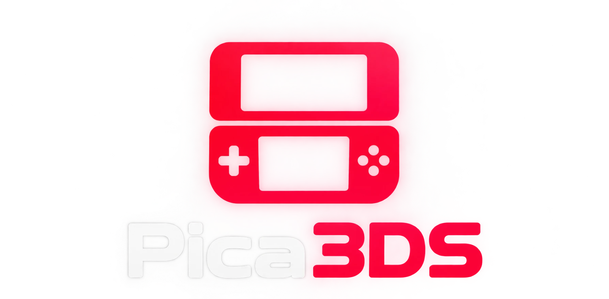

<p align="center"></p>

# Pica3DS

An experimental Nintendo 3DS emulator written from scratch in JavaScript. It runs in the browser with no build step, no install and no server.

It runs homebrew built with devkitARM/libctru and some commercial games, with 3D graphics drawn on your graphics card (WebGL 2), sound, and a software reference renderer that the fast paths are tested against.

> **Bring your own games.** This repository contains no Nintendo games, firmware, system files or encryption keys. Use dumps of games and system data you own, decrypted on your own console.

## Quick start

1. Download or clone this repository.
2. Open `index.html` in a browser. Double-clicking it usually works; if your browser blocks something when opened from a file, serve the folder instead (for example `npx serve` or `python -m http.server`) and open the address it prints.
3. Click **Open** and choose a `.3dsx`, `.elf`, or decrypted `.3ds` / `.cci` / `.cxi` file, drag a file onto the page, or press **Run the demo**.
4. Click anywhere on the page once to let the browser start sound.

Open `index.html?demo` to start the demo automatically.

## Status

| Works | Partly works | Not yet |
|---|---|---|
| Homebrew (libctru, citro2d/citro3d) | Commercial games: tested with *New Super Mario Bros. 2* (plays levels) and *Cut the Rope: Triple Treat* (boots) | Audio effects (reverb, delay) and per-voice filters |
| 3D graphics (vertex shaders, textures, lighting, fog, blending, depth/stencil) | Speed: homebrew and 2D screens run at full speed, heavy 3D scenes are still slow (see [Performance](#performance)) | Procedural textures, gas rendering |
| | Geometry shaders: point mode (the mode citro3d uses); variable- and fixed-size primitive modes are not emulated yet | |
| Save data and extra data (kept in memory) | System applets: the Mii selector picks a stand-in Mii; the keyboard and error display close straight away | Networking, camera, the stereoscopic 3D effect |
| Sound: 24 DSP voices, PCM8/PCM16/DSP-ADPCM, mixing and volume | Microphone (records silence), video (`y2r` colour conversion) | |
| System files from your own console, or built-in stand-ins | | `.cia` files, encrypted games, and game files over about 2 GB (read into memory whole) |

## How it works

| Part | File | Notes |
|---|---|---|
| ARM11 CPU | `src/cpu.js` | ARMv6K interpreter: ARM and Thumb instructions, ARMv6 media/SIMD instructions, exclusive loads/stores, and VFPv2 floating point, plus a compiler for hot ARM code |
| Memory | `src/memory.js` | 4 KB page table with aligned fast paths |
| Kernel (HLE) | `src/kernel.js` | Threads with a priority scheduler, mutexes, semaphores, events, timers, address arbiters, shared memory, and heap/linear memory (old and new linear heap layouts) |
| 3D GPU | `src/gpu.js` | PICA200 in software: command lists, vertex and geometry shaders, clipping, rasterizer, all 14 texture formats including ETC1, texture combiners, fragment lighting, fog, and the output merger. This is also the reference the WebGL renderer is checked against |
| Audio (HLE) | `src/audio.js` | The DSP's audio pipeline: reads the voices the game sets up in DSP shared memory, plays their buffer queues (PCM8, PCM16, DSP-ADPCM), resamples, mixes with the game's gains and reports playback status back. The browser plays it through an AudioWorklet |
| WebGL renderer | `src/glrender.js` | Draws with your graphics card: vertex shaders translated to GLSL, texture combiners, lighting and fog as generated fragment shaders, render targets kept on the graphics card and copied to emulated memory only when something reads them, display transfers and screen output without copies |
| Services (HLE) | `src/services.js` | `srv:`, `APT` (parameters, shared font, library applets), `gsp::Gpu`, `hid`, `fs` (RomFS, save data, extra data, SD card), `dsp` (with `src/audio.js`), `y2r:u` (YUV to RGB for video), `mic:u` (silence), `cfg`, `ptm`, `err:f`. Other services are stubbed |
| System data | `src/sysdata.js` | RomFS builder, plus stand-ins for missing system data (Mii data, system fonts, bad word list) and an empty archive for any other |
| Loader | `src/loader.js` | `.3dsx`, ARM ELF, and decrypted `.3ds`/`.cci` (NCSD) and `.cxi` (NCCH), including compressed code and RomFS |
| Front-end | `index.html`, `src/main.js` | Both screens (stacked, side by side or top only; fit to window or fixed size; fullscreen), sound with volume, rebindable keyboard controls, gamepad, performance graph, settings, system files manager, and a log |

## Performance

By default the **graphics card renderer** (WebGL 2) draws the 3DS graphics; **Software (CPU)** in the Renderer menu uses the reference software renderer instead. Known differences of the graphics card renderer: logic ops other than copy, clear, set and invert are drawn as a copy; the exclusive scissor mode is ignored; depth buffers are not copied back to emulated memory; on vertices shaded by the graphics card, lighting quaternions are not flipped onto the short arc between vertices.

Three compilers turn hot code into JavaScript at run time: ARM code blocks (`src/cpu.js`), shader programs, and a rasterizer for each render state (`src/gpu.js`). Each one has an interpreter counterpart that gives the same results, and tests check that they match (see below). They are on by default; untick **Compilers (JIT)** to use the interpreters.

The **Performance** tab shows game FPS (emulated frames per second), display FPS (screen updates per second), speed (compared with a real 3DS), a live frame-time graph, and the average and 95th-percentile frame time split into CPU, GPU, copies and presenting. **Settings → FPS counter on screen** shows FPS and speed over the game.

Measured with Node 24 on a Ryzen 7 5800X (`node tools/bench.js`; time per emulated frame, budget 16.7 ms):

| Scene | Before (avg / p95) | Software renderer, Node (avg / p95) | Graphics card renderer, browser (avg / p95) |
|---|---|---|---|
| Bundled demo (CPU-bound homebrew) | 12.4 / 13.8 ms | 2.1 / 2.4 ms | 2.9 ms (60 FPS) |
| *New Super Mario Bros. 2* intro pages (2D) | 27.8 / 38.6 ms | 12.5 / 15.1 ms | 7.7 / 10.5 ms |
| *New Super Mario Bros. 2* 3D opening | 210.5 / 300.5 ms | 89.3 / 97.4 ms | 27.9 / 43.6 ms |
| *New Super Mario Bros. 2* title screen (3D) | about 79 ms | 39 ms | 20.2 / 31.7 ms |
| *New Super Mario Bros. 2* World 1-1 (foreground Brave window) | 31.4 / 43.3 ms | – | 12.0 / 14.2 ms (60 FPS) |

Levels in *New Super Mario Bros. 2* animate tiles by rewriting small parts of a 1024×1024 ETC1 texture atlas most frames; the texture cache now decodes and uploads only the 8×8 tiles that changed instead of the whole atlas (23 ms per change before). Except for World 1-1, the browser numbers were taken in a background browser pane, which browsers run at lower priority; a foreground window is faster. The software renderer is limited by drawing every pixel on one thread (the opening cutscene draws each pixel of the top screen about ten times per frame).

`tests/gpu/webgl.html` renders the GPU regression scenes with both renderers and shows the differences (serve the folder over http to open it).

## Controls

| 3DS | Keyboard |
|---|---|
| D-Pad | Arrow keys |
| Circle Pad | I / J / K / L |
| A / B / X / Y | X / Z / S / A |
| L / R | Q / W |
| Start / Select | Enter / Backspace |
| ZL / ZR | 1 / 2 |
| Touch screen | Mouse or finger on the bottom screen |

Keys can be changed in the **Controls** tab. Gamepads use the standard browser mapping. Shortcuts: **P** pause, **F** fullscreen, **M** mute (when the key is not bound to a button). Browsers start sound only after a click or key press on the page.

## Games and system files

**Games** must be decrypted. Retail dumps are usually encrypted, and this emulator does not include console keys. Decrypt your own dump on your 3DS, for example with GodMode9 ("Decrypt file").

**System files.** Some games read data that ships with the console, such as Mii data or the system font. If one is missing, the emulator uses a built-in stand-in where it has one (Mii data, system fonts, bad word list) and an empty archive for any other, so games are not stopped just because a file is missing. The log names each file that was replaced, and if a game stops after reading from an empty one, the error screen names it. To use the real files from your own console:

1. On your 3DS, in GodMode9, open `[1:] SYSNAND CTRNAND/title/0004009b/<title>/content/`.
2. Select the `.app` file and choose **NCCH image options → Decrypt file**. The decrypted copy goes to `gm9/out/` on your SD card.
3. In the emulator, open **Settings → System files → Add system files…** (or drag the `.app` onto the page). Files are saved in your browser, so you only add them once.

## Development

```
node tools/test.js                        # regression suite
node tests/gpu/scenes.js                  # GPU tests only
node tools/bench.js app.3dsx --frames=600 --skip=60          # frame-time benchmark (avg, median, p95, p99, CPU/GPU split)
node tools/bench.js app.3dsx --no-cpu-jit --no-shader-jit --no-raster-jit   # the same with the interpreters
node tools/run.js app.3dsx 120 shot       # run headless for 120 frames, save shot-top.png / shot-bottom.png
node tools/run.js app.3dsx 300 shot --keys=A@60-70,START@200-205
```

The tests cover:

- **CPU:** 64-bit integer math, VFP float/double, libm, printf/scanf, qsort, CRC32 and setjmp/longjmp, compared against output computed independently in Python, plus hand-written Thumb assembly with ARM↔Thumb interworking.
- **Programs:** the libctru hello-world and thread examples, and the bundled demo.
- **RomFS and loading:** the libctru RomFS example in four formats (`.3dsx`, `.3ds`, compressed `.3ds`, `.cxi`), rejection of encrypted images, reading system data files, and the RomFS builder.
- **GPU:** hand-built command lists and shader binaries rendered and checked pixel by pixel. They cover fill rules, color interpolation, depth, textures, ETC1, shader math and flow control, geometry shaders, immediate mode, culling, scissor, stencil, blending, alpha test and texture combiners.
- **GPU regression scenes** (`tests/gpu/regress.js`): seeded random scenes at 400×240 (all texture formats and wrap modes, NaN and huge texture coordinates, blending and logic ops in every color format, stencil, scissor, fog, lighting, clipping). Each scene must give identical bytes from the reference and compiled rasterizers and match a recorded hash.
- **Texture cache:** partial re-decoding of changed tiles matches a full decode in every tested format.
- **Stand-in system data:** the bad word list, the shared font archives (LZ11) and the empty fallback archive.
- **Compilers against interpreters:** random shader programs (`tests/gpu/shaderfuzz.js`) and random ARM instruction sequences (`tests/cpu/armfuzz.js`), plus whole test programs run in lockstep with and without the ARM compiler, comparing registers, flags, screens and memory after every frame.

### Packaging homebrew as .3ds

```
node tools/make3ds.js app.elf app.3ds [--from3dsx=app.3dsx] [--compress] [--cxi]
```

This builds a decrypted (NoCrypto) cartridge image from a libctru ELF. `--from3dsx` copies the RomFS and icon from the matching `.3dsx`, `--compress` BLZ-compresses the code, and `--cxi` writes a bare NCCH instead of a `.3ds`.

To rebuild the test ROMs or the demo (`demo/source/main.c`), install [devkitPro](https://devkitpro.org/wiki/Getting_Started) with the `3ds-dev` group and use the standard libctru Makefile template.

## License

Pica3DS is licensed under the GNU General Public License v3.0. See [LICENSE](LICENSE).

## Legal

This project is not affiliated with or endorsed by Nintendo. "Nintendo 3DS" is a trademark of Nintendo. The emulator is written from scratch and contains no Nintendo code, firmware, keys or game data.
